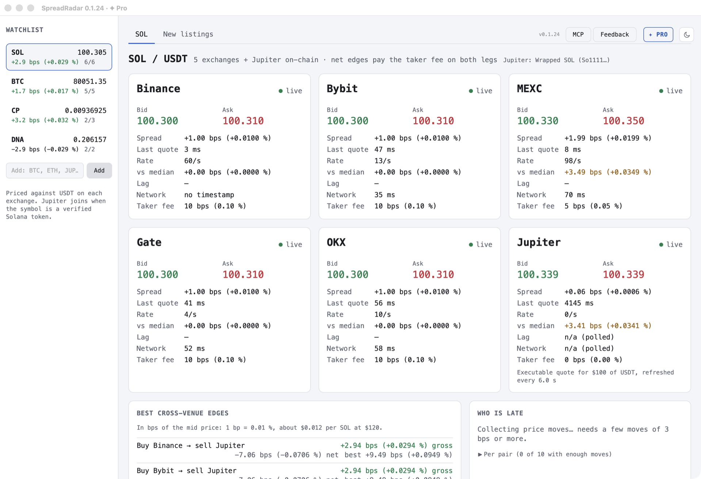

# SpreadRadar



A desktop app that watches the same crypto asset across five exchanges and
Solana on-chain at once: where the price differs, which venue moves first, and
which tokens just listed. It can also swap SOL/USDT on-chain through Jupiter
from a hot wallet it creates for you.

Built with [Dioxus](https://dioxuslabs.com/) (Rust) · macOS · Windows · Linux

> **Not financial advice.** SpreadRadar shows market data and can place real
> trades. Prices can be stale, venues can be down, and a spread on screen is
> not a profit in your account. Use it at your own risk, and fund the hot
> wallet only with what you can afford to lose.

---

## Install

Builds are **free for individuals** and download from
[mayorana.ch](https://mayorana.ch/en/apps/spreadradar). Each release on GitHub
carries a `latest.json` with the `sha256` of every artifact, so you can verify
what you downloaded.

### macOS (Apple Silicon and Intel)

Download
[`spreadradar-macos.dmg`](https://mayorana.ch/downloads/spreadradar/latest/spreadradar-macos.dmg),
open it, and drag **SpreadRadar** to Applications. Signed with Apple Developer
ID and notarized — opens with a normal double-click.

### Windows

Download
[`spreadradar-setup.exe`](https://mayorana.ch/downloads/spreadradar/latest/spreadradar-setup.exe)
and run it. It installs for your user only, with no admin prompt. Signed with
Azure Trusted Signing. Needs the Microsoft Edge WebView2 Runtime, which
Windows 11 and up-to-date Windows 10 already have; the installer tells you if
it is missing.

### Linux (x86_64)

```bash
curl -L https://mayorana.ch/downloads/spreadradar/latest/spreadradar-linux-x86_64.tar.gz | tar xz
cd spreadradar-linux-x86_64
sudo ./setup-linux.sh && ./spreadradar
```

`setup-linux.sh` installs WebKitGTK, libxdo and OpenSSL 3 (Debian/Ubuntu,
Fedora, Arch) and adds SpreadRadar to your app launcher. Runs on Ubuntu 22.04+,
Debian 12+ and current Fedora and Arch.

---

## What's new

Every version and what changed in it:
[Release notes](https://mayorana.ch/en/apps/spreadradar/releases). The notes are
written in [`CHANGELOG.md`](CHANGELOG.md) and published from there.

---

## What it does

### Watchlist

Follow any asset by its ticker (BTC, ETH, JUP, BONK…). The free version follows
3 at once; [SpreadRadar Pro](https://mayorana.ch/en/apps/spreadradar) follows
any number. Assets saved past the limit stay in the list, marked 🔒 Pro, and
are followed again as soon as there is room or a licence. Each one is quoted
against USDT on **Binance, Bybit, OKX, MEXC and Gate**, plus **Jupiter** for
Solana tokens. If Gate does not trade a followed asset yet, SpreadRadar polls
Gate's public API and tells you when the coin, then its USDT pair, appears.

### Market tab

- **Venue cards** — best bid and ask on each venue, with a warning when a feed
  goes stale
- **Best cross-venue edges** — buy here, sell there, gross and **net** of the
  taker fee on both legs, in basis points
- **Who is late** — for each venue, how many milliseconds its price trails the
  others on average
- **Event log** — edges worth a look, stale feeds, connection drops and
  listing steps, timestamped to the millisecond

### New listings tab

Tokens Gate or MEXC listed against USDT in the last few days (or have
scheduled) that Binance spot does not list, scored by volume, how many other
exchanges list them, market cap, and whether Binance already follows them
through futures or Binance Alpha. Tokens are matched by ticker across
exchanges, so two different tokens sharing a ticker look like one.

### On-chain trading (SOL/USDT)

- **Create hot wallet** makes a Solana keyfile only your user can read
- Swaps go through Jupiter and are signed on your machine: the wallet's key
  never leaves it, only the signed transaction does
- Starts in **DRY RUN** every time. **LIVE** has to be switched on, and asks
  for confirmation
- Hard limits per trade, per day, on slippage and on priority fee — the
  settings file can lower them but never raise them above the built-in caps

---

## Use from Claude (MCP)

`spreadradar mcp` serves the market to an MCP client over stdio, with no
window (`src/mcp.rs`). It runs its own market and scanner, the same
`spread_core::run` and `scanner::run` as the app, for as long as the client
keeps it open. The **MCP** button next to Get Pro… shows the Claude Desktop
config and the Claude Code command. The tools: `watchlist`, `asset` (with
`watch_secs` to collect moves for lead/lag), `add_asset`, `remove_asset` and
`new_listings`. The free version's limit applies, from the same licence check.

Both the app and the server save `watchlist.json`; each market checks it
every 2 s and follows what the other one saved (`Market::reload_if_changed`).
Trading is not exposed: swaps stay in the app, behind its dry run and limits.

## Settings

Everything lives in one folder:

| OS | Folder |
|----|--------|
| macOS / Linux | `~/.config/spreadwatch/` |
| Windows | `%LOCALAPPDATA%\Spreadwatch\` |

It holds the hot wallet (`hot-wallet.json`), the optional settings file
(`trade.toml`), your watchlist and small caches. Copy
[`trade.example.toml`](trade.example.toml) to `trade.toml` there to set a
Solana RPC provider, a Jupiter API key or lower limits.

**Back up `hot-wallet.json`.** It is the only copy of the wallet's key:
uninstalling SpreadRadar leaves the folder alone for that reason, and anyone who
gets the file can spend from the wallet. SpreadRadar refuses to load a keyfile
other users on the machine can read.

Set `DISABLE_UPDATE_CHECK=1` to stop the startup check for a newer version.

---

## Contributing

### Build from source

```bash
git clone https://github.com/bennekrouf/spreadradar.git
cd spreadradar
git config core.hooksPath .githooks   # secret scan + rustfmt before each commit
cargo run --release
```

Linux needs the development packages:
`libwebkit2gtk-4.1-dev libgtk-3-dev libxdo-dev libssl-dev pkg-config`.

`spread-core` holds the feeds, the engine and trading with no UI dependency.
A headless view of the market runs with:

```bash
RUST_LOG=info cargo run -p spread-core --bin spread-cli
```

### Project layout

```
src/                    Desktop app — Dioxus UI, update check, notice banner
  components/           Watchlist, venue cards, routes, lag, scanner, trade panel
crates/spread-core/     Feeds, engine, new-listing scanner, Jupiter trading
tests/no_secrets.rs     Fails the build if a tracked file carries a wallet or API key
scripts/
  release.sh            Cut a release (bump version, stamp notes, tag, push)
  changelog_to_json.py  CHANGELOG.md → releases.json + GitHub Release body
  setup-linux.sh        Linux runtime installer shipped in the tarball
installer/installer.iss Inno Setup script → spreadradar-setup.exe
.github/workflows/
  ci.yml                fmt, test and clippy on macOS, Windows and Linux
  release-notes.yml     Every app change adds a CHANGELOG.md note
  release.yml           Build, sign, notarize and publish all platforms
```

### Releasing

```bash
./scripts/release.sh            # auto-bump patch, confirm, push
./scripts/release.sh --minor    # bump minor
./scripts/release.sh 1.0.0      # explicit version
./scripts/release.sh --dry-run  # preview only
```

Pushing a `v*` tag builds every platform (macOS universal DMG, signed and
notarized; Windows installer signed with Azure Trusted Signing; Linux tarball),
publishes them to mayorana.ch, and creates a GitHub Release carrying the notes
and `latest.json`. The binaries are not attached to the GitHub Release.

---

## Licence

Source-available under the [PolyForm Noncommercial License 1.0.0](LICENSE).

- **Free** for personal use, learning, research and hobby projects, and for
  charities, schools, universities and government institutions.
- **Commercial use requires a licence** — including a solo consultant using it
  on client work, and an employee using it at their job. That licence is
  [SpreadRadar Pro](https://mayorana.ch/en/apps/spreadradar), bought on
  SpreadRadar's page; it also lifts the free version's limit of 3 followed
  assets.

The name, logo and icons are trademarks and are not covered by that licence —
fork it and rebrand it. See [TRADEMARK.md](TRADEMARK.md).
